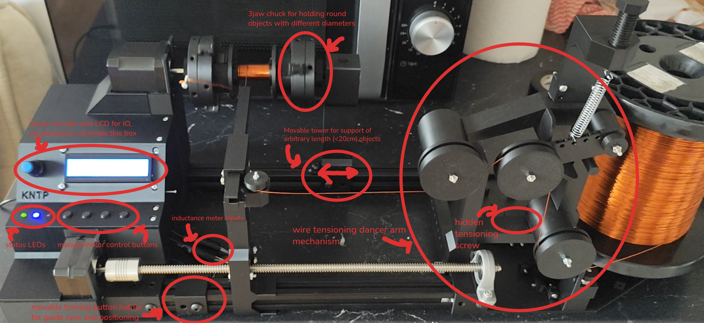
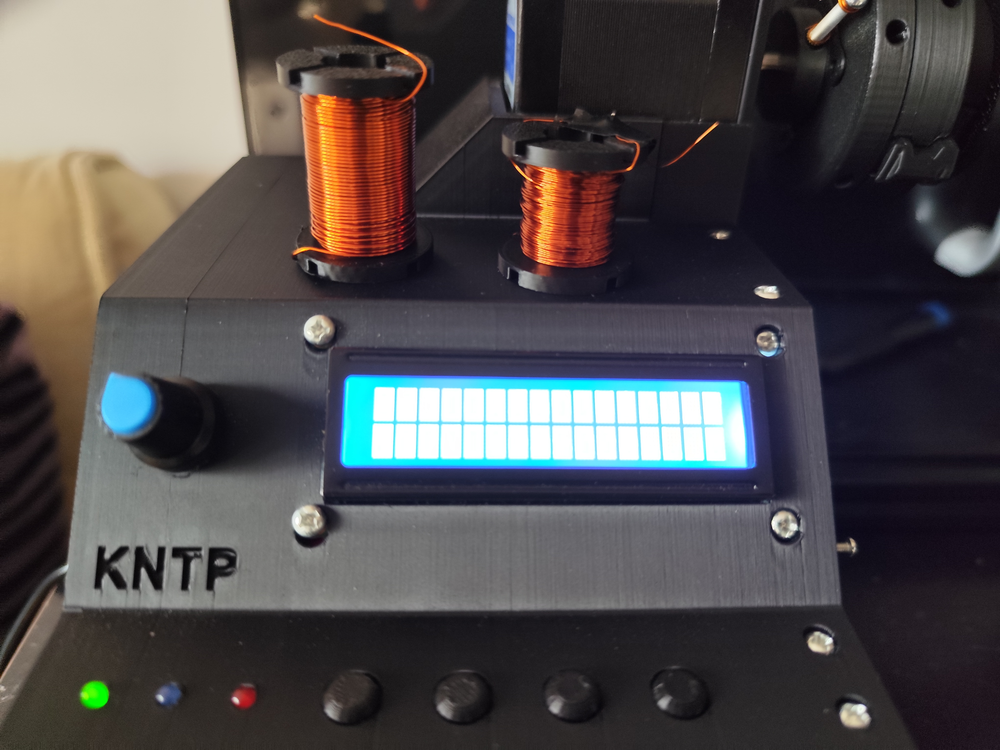
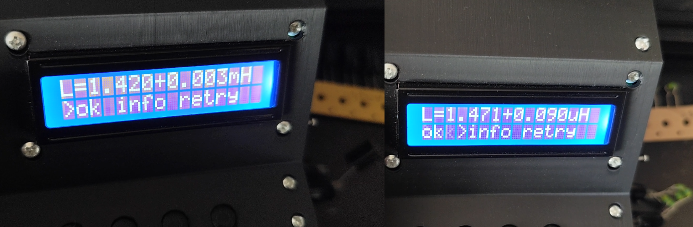
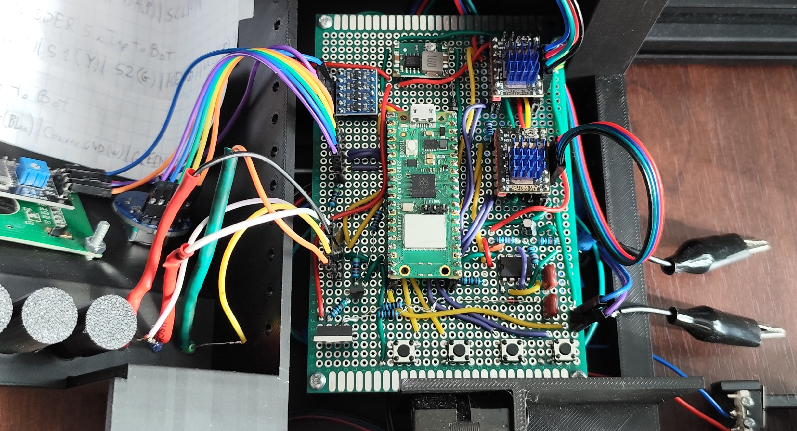
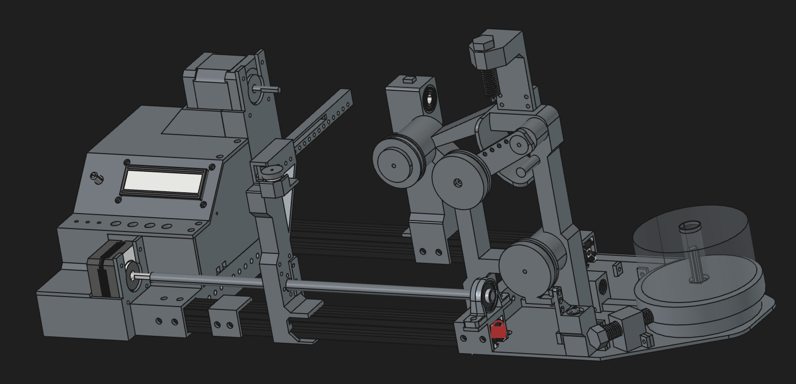
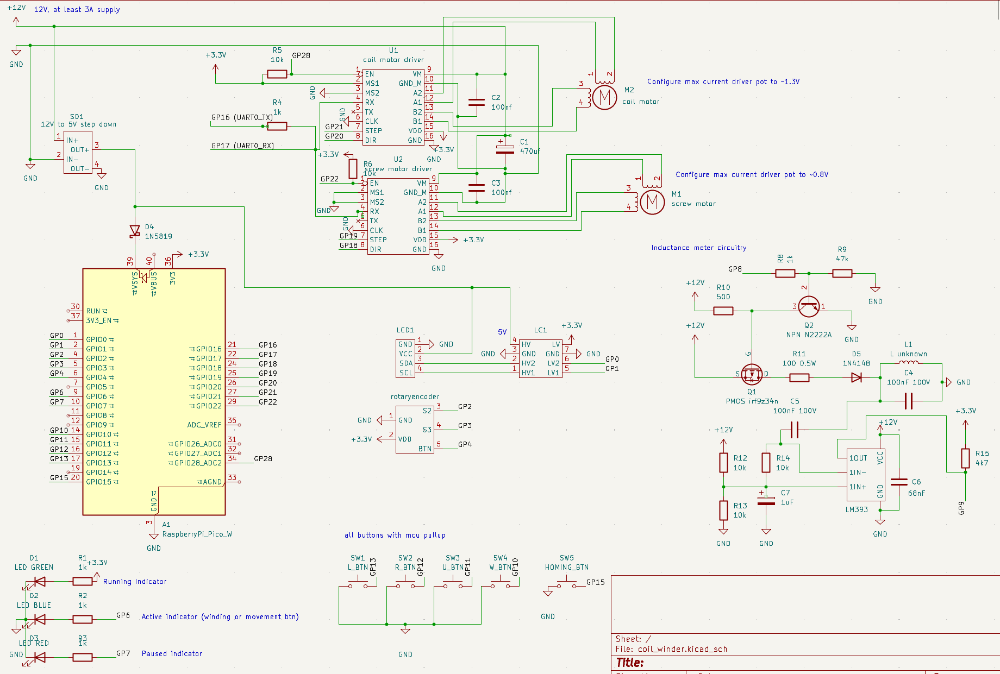

# Automatic Coil Winding Machine and Inductance Meter

  
   
  Winding 200 turns of 0.5mm (24AWG) wire on 28mm object

### More images available at the [bottom](#other-images). Also see full [youtube video](https://www.youtube.com/watch?v=4JAEhnQUCKE) featuring configuration demo, full winding process, different spool and inductance meter testing.

# Repository contents

- [./src](./src) - raspberry pi pico firmware
- [./electronics](./electronics/) - kicad schematics for the machine
- [./cad](./cad) - FreeCad 1.1.0 designs of the machine

I used vscode Raspberry PI Pico extension for development, building the project should be straightforward with it. Use the extension to open the `src` directory.

Electronics were manually soldered on a 80x120 perfboard so kicad files don't include PCB design. Inductance meter is optional but was something I needed and could relatively easily fit on that board.

CAD directory has 2 projects, the main one with full assembly is called `coil_winder.FCStd`, the other one had some early prototypes and other misc items, including modified [3 jaw chuck](https://www.thingiverse.com/thing:2670620) I used for mounting items for winding.

Parts were 3d printed on BambuLab P1S with PLA.

# Machine Features

### 1. Coil Winder software features:

- Configurable wire diameter, tested with 0.25mm (30AWG) and 0.5mm (24AWG)
- Configurable object length (object diamater doesn't matter) and winding start offset
- Configurable winding pitch (spacing between turns)
- Configurable winding speed (from 0 to 150rpm), arbitrary number of turns, linear acceleration during winding startup
- Runtime guide speed changing if configuration turned out to be non-ideal and wire would otherwise accumulate unevenly
- Pause, stop and resume features
- Homing button for long-run synchronisation and moving guide to the start
- Runtime stall detection (e.g. due to wire entanglement) and machine pausing, with configurable stall threshold
- Rotary encoder and LCD screen for IO
- 4 push buttons for manual async left/right guide motor control and wind/unwind motor control
- Power / error / motor engergized status LEDs

### 2. Coil Winder hardware features:

- Spool plate with easily swappable spool holders, tested with large 18cm tall 1kg spool and smaller ~8cm tall 0.5kg spool (see video)
- Plate on a very low friction thrust bearing with screw with felt pad for plate friction adjustment to keep proper tension
- Dancer Arm mechanism for keeping wire under tension all the time even if plate overshoots
- 2 separate machine parts connected with arbitrary length aluminium extrusions and trapezoid screw so machine size can be adjusted as needed
- Three jaw chuck for attaching arbitrary round objects for winding, can use arbitrary 3d-printed adapters for other objects

### 3. Inductance meter:

- Measures LC tank ringing frequency after triggering short power pulses and computes L after analyzing statistics of multiple measurements
- Tested (and accurate) for range from 1uH to 10mH, best suited for linear inductors
- Manual mode to help with non-linear inductors (ferrite/iron cores), as L depends on current automatic mode that tries multiple power pulse durations can't provide one proper result. In manual mode pulse duration can be explicitly configured. Device, however, can't provide a neat `L(I)` only a rough estimate, external osciloscope can be easily attached when needed
- Convenient input via 2 aligator clips

## Hardware

- Raspberry Pi Pico W (WiFi not used)
- Nema 17HS19-2004S1-C44 and Nema17 17HS4023 stepper motors
- 2 x BigTreeTech TMC2209 v1.3 stepper motor drivers
- Rotary encoder and LCD 1602 2x16 with HD44780 driver
- 2x U624ZZ U bearing, 5x 608-2RS bearing, 1x KP08 bearing, 1x 8mm inner and 16mm outer 5mm high thrust bearing (no idea what model)
- 30cm 2mm T8 trapezoid screw and nut, 2x 30cm 20x20 T shaped aluminium extrusion, length is arbitrary (>15cm) but must match
- A lot of screws and see kicad schematics for other minor electronic components

Total estimated cost of parts would be somewhere around 80$ (in Poland).

# Other images

  
   
  Machine with some highlighted parts

---

  
   
  Small sample coils with 200 turns of 24AWG and 300 turns of 30AWG wire

---

  
   
  Inductance measurements (with uncertainty) of 1.5mH inductor and of 5x 6.8uH in parallel equivalent to single 1.36uH (both results well within manufacturer tolerances)

---

  
   
  Eletronics soldered on a perfboard, top is detachable (wires connected to goldpin inputs)

---

  
   
  Machine assembly in FreeCad (not all parts shown, not all latest)

---

  
   
  Circuitry in Kicad

# Acknowledgment

Machine was heavily inspired by these 2 but redesigned and implemented from scratch on a different hardware, optimized for my own requirements:

- https://www.youtube.com/watch?v=PqTE3bOs5cE
- https://www.youtube.com/watch?v=GJcQfJ6JTZg
